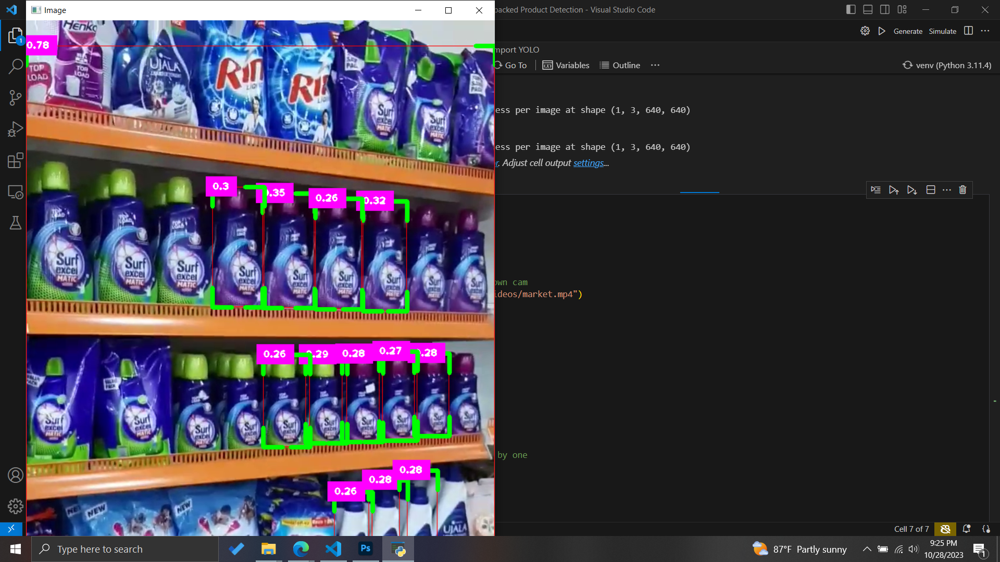

# Retail Inventory Management with Object Detection

This repository contains the research paper and code related to the application of object detection for retail inventory management. The paper discusses the utilization of the YOLOv8 object detection algorithm to detect and locate products on densely packed supermarket shelves.

## Table of Contents

- [Introduction](#introduction)
- [Dataset](#dataset)
- [Methodology](#methodology)
- [Results](#results)
- [Conclusion](#conclusion)
- [Usage](#usage)
- [License](#license)

🎥 **Demo video:** [Densely Packed Product Detection using Computer Vision](https://github.com/Manimohan05/Project--Densely-packed-product-detection/raw/main/Densely%20Packed%20Product%20Detection%20using%20Computer%20Vision%20Project%20(2).mp4)

## Introduction

The significance of this research lies in its contribution to computer vision and object detection in retail inventory management. Efficiently and accurately detecting products on supermarket shelves has transformative implications for the retail industry. This paper explores the adaptation of the YOLOv8 algorithm to tackle this challenging task, using the SKU-110K dataset.

## Dataset

The SKU-110K dataset serves as the foundation for this research. It is a representative collection of images from retail settings, featuring densely packed supermarket shelves. This section discusses the dataset's characteristics, including scale, distribution, and unique challenges.

## Methodology

The methodology section delves into the preprocessing steps, automatic annotation, data generation, and model training. It outlines the critical processes involved in preparing the dataset and training the YOLOv8 model for retail product detection.

## Results

The results section presents an analysis of the model's performance, including key metrics such as mean Average Precision (mAP), precision, recall, and F1 score. Visualizations of detection results and discussions on hyperparameters and training strategies are included.

## Screenshots

You can find some screenshots of our project below:

## Conclusion

The conclusion summarizes the key takeaways of the research and discusses the broader implications of efficient object detection in retail inventory management. It also outlines future directions for further research in this field.

## Usage

To replicate the research, open `Densely Packed Product Detection using Computer Vision.ipynb` (PyTorch + Ultralytics YOLOv8, CUDA GPU recommended) and run the cells in order. Trained weights are in `YOLOweights/`, and the full write-up is in `en3160_project_200377M_200552V.pdf`.

## License

This project is licensed under the MIT License.
